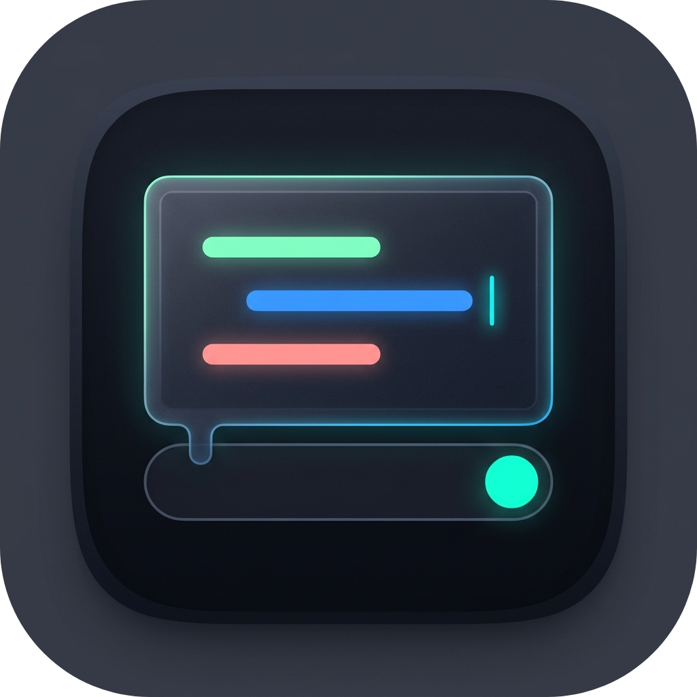
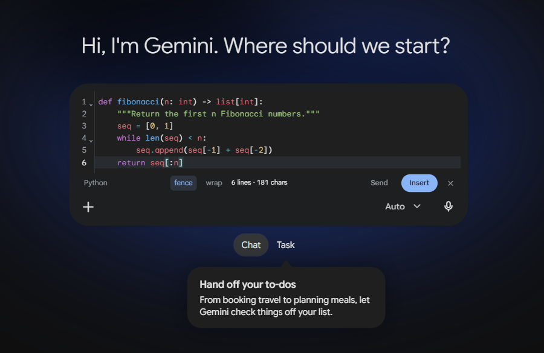
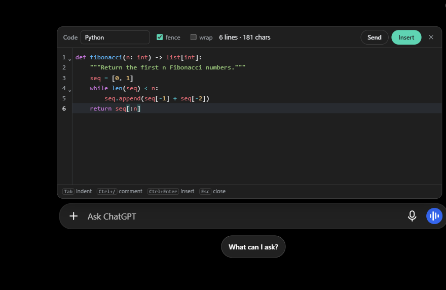
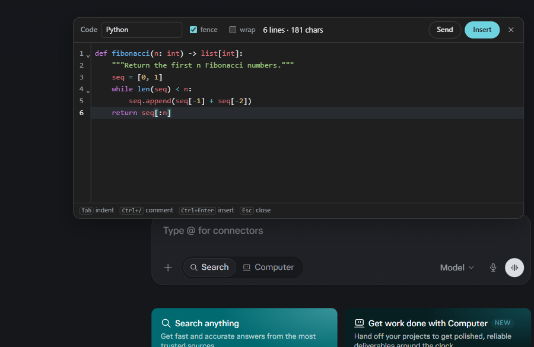
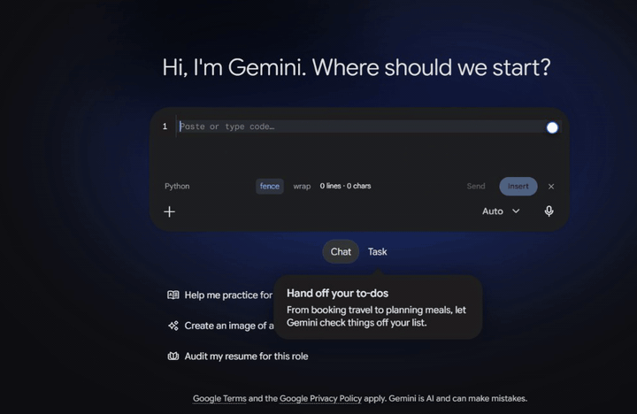

# Inset

<p align="center">
  
</p>

<p align="center">
  <strong>A real code editor inside AI chat.</strong><br />
  CodeMirror 6 in the prompt box of Gemini, ChatGPT, Claude, DeepSeek, Copilot and Perplexity.
</p>

<p align="center">
  <a href="https://github.com/deakR/inset/releases/latest"></a>
  <a href="https://github.com/deakR/inset/blob/main/LICENSE"></a>
  
</p>

<div align="center">
  <table>
    <tr>
      <td align="center"><br /><sub>Gemini</sub></td>
      <td align="center"><br /><sub>ChatGPT</sub></td>
    </tr>
    <tr>
      <td align="center"><br /><sub>Perplexity</sub></td>
      <td align="center"><br /><sub>How it works</sub></td>
    </tr>
  </table>
</div>
<p align="center"><sub>Real captures from Gemini, ChatGPT and Perplexity, plus a live demo.</sub></p>

## Highlights

- **A real editor, not a textarea** — CodeMirror 6 with syntax highlighting, line numbers, bracket matching, search and undo/redo.
- **Language aware** — 21 languages, correct indentation, auto-detection on paste and fenced Markdown on insert.
- **Fits the host composer** — docked inside Gemini, floating above the rest, with a `<>` launcher pinned to the site's own action row.
- **Nothing gets lost** — draft autosave, duplicate-insert guard and clipboard fallback.
- **Redesign-proof** — if a site changes, **Pick prompt box** in the popup repairs it locally.
- **Private by design** — no telemetry, no backend, no external requests.

## Supported sites

Google Gemini (docked) · ChatGPT · Claude · DeepSeek · Microsoft Copilot · Perplexity

Chrome / Edge / Brave / Arc 114+ · Firefox 140+ · Manifest V3

## Install

**Quick install (no build tools):**

1. Download the [latest release](https://github.com/deakR/inset/releases/latest) and unzip it.
2. Chromium: open `chrome://extensions`, enable **Developer mode**, click **Load unpacked** and select the folder.
3. Firefox: open `about:debugging#/runtime/this-firefox`, choose **Load Temporary Add-on…** and pick `manifest.json`.

**From source:**

```bash
git clone https://github.com/deakR/inset.git
cd inset
npm install
npm run build   # then load dist/ as above
```

## Shortcuts

| Keys | Action |
|:--|:--|
| <kbd>Ctrl</kbd>/<kbd>⌘</kbd> + <kbd>Shift</kbd> + <kbd>E</kbd> | Toggle the editor (configurable) |
| <kbd>Ctrl</kbd>/<kbd>⌘</kbd> + <kbd>Enter</kbd> | Insert into the prompt box |
| <kbd>Tab</kbd> / <kbd>Shift</kbd> + <kbd>Tab</kbd> | Indent / dedent |
| <kbd>Ctrl</kbd>/<kbd>⌘</kbd> + <kbd>/</kbd> | Toggle line comment |
| <kbd>Ctrl</kbd>/<kbd>⌘</kbd> + <kbd>F</kbd> | In-editor search |
| <kbd>Esc</kbd> | Close the editor |

## Languages

Python, JavaScript, TypeScript, Go, Rust, Java, Kotlin, Scala, C/C++, C#, PHP, Ruby, Dart, Shell, HTML, CSS, XML, Markdown, JSON, YAML, SQL.

## Development

```bash
npm test                          # Playwright suite
npm run probe -- https://chatgpt.com/   # inspect a site
npm run package                   # release zips in release/
```

Adding a site is an adapter in `src/sites/` plus a fixture in `fixtures/`; the generic scorer still finds a usable prompt box without either.

## Privacy

Everything runs locally. The extension has no backend, makes no analytics or telemetry requests, and stores settings, drafts and picked prompt boxes in the browser's local extension storage.

## License

MIT. See [LICENSE](LICENSE).
