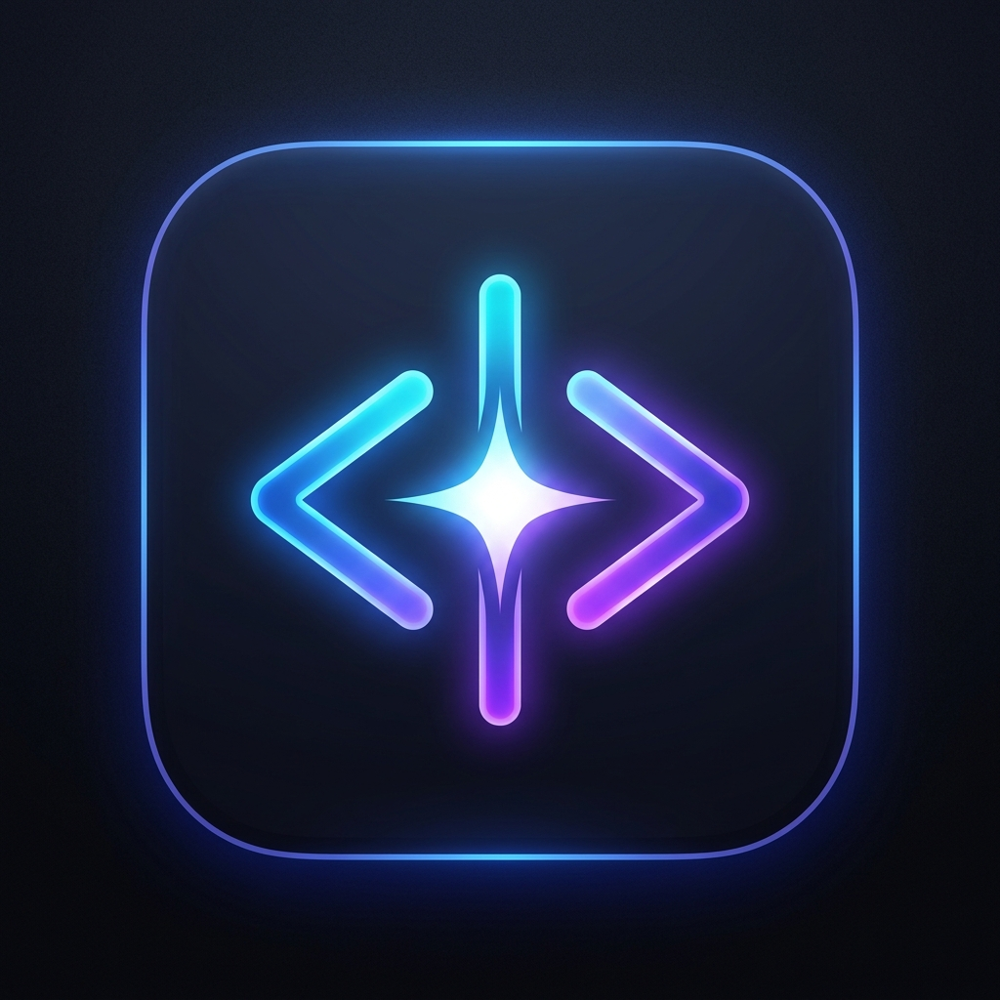
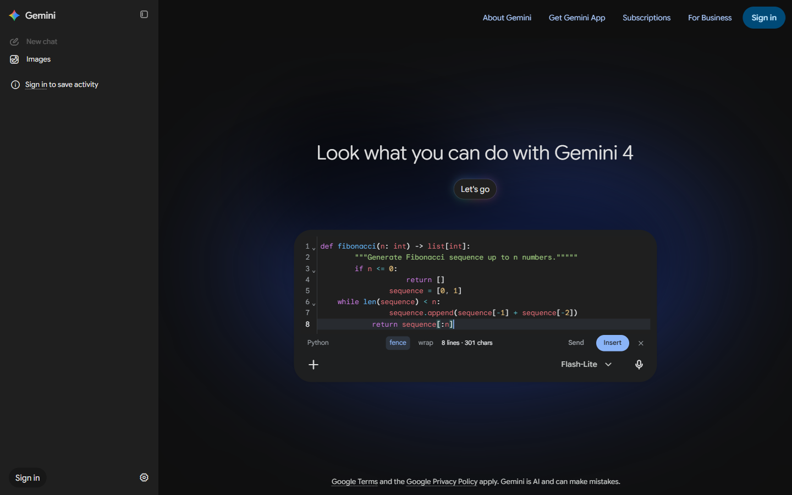
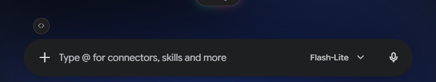
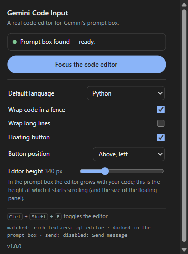

# Code Input in AI Web Apps

<p align="center">
  
</p>

<p align="center">
  A Manifest V3 browser extension that docks a <strong>real code editor</strong> directly into web prompt boxes.
  <br />
  Syntax highlighting, language-aware indentation, line numbers, bracket matching, comment toggling, and smart fenced blocks.
</p>

<p align="center">
  <a href="https://github.com/deakR/code-inputin-aiwebapps/releases/latest"></a>
  <a href="https://github.com/deakR/code-inputin-aiwebapps/blob/main/LICENSE"></a>
  
  
  
</p>

> [!NOTE]
> Currently supports **Google Gemini** ([gemini.google.com](https://gemini.google.com)). Support for additional AI web apps (ChatGPT, Claude, Copilot, DeepSeek, etc.) is in active development and coming soon!

---

## Overview

Writing code in a standard prompt textarea often strips indentation, mashes bracket pairs, and lacks readability. **Code Input in AI Web Apps** embeds CodeMirror 6 directly into the prompt box.

The editor docks cleanly inside the input container, styled natively with Google Sans and Google Sans Mono to blend seamlessly into Gemini's dark theme.

<p align="center">
  
</p>

---

## Installation

### 📦 Quick Install (Download & Unpack)

**No Node.js or build tools required.**

1. **Download the pre-packaged zip**:
   👉 **[Download gemini-code-input-1.0.0.zip](https://github.com/deakR/code-inputin-aiwebapps/releases/latest/download/gemini-code-input-1.0.0.zip)** (or get it from the [Releases](https://github.com/deakR/code-inputin-aiwebapps/releases) page).
2. **Unzip** `gemini-code-input-1.0.0.zip` into a folder on your computer.
3. **Load unpacked into your browser**:

#### Chromium (Chrome, Edge, Brave, Arc, Opera)
1. Navigate to your browser's extension page:
   - **Chrome**: `chrome://extensions`
   - **Edge**: `edge://extensions`
   - **Brave**: `brave://extensions`
   - **Arc**: `arc://extensions`
2. Turn on **Developer mode** (toggle in the top-right corner).
3. Click **Load unpacked** and select the unzipped folder.

#### Mozilla Firefox
1. Navigate to `about:debugging#/runtime/this-firefox`.
2. Click **Load Temporary Add-on…**.
3. Select `manifest.json` from the unzipped folder.

4. Open [gemini.google.com](https://gemini.google.com) and start coding!

---

### Building from Source (Developers)

If you wish to build or modify the extension from source:

```bash
# Clone the repository
git clone https://github.com/deakR/code-inputin-aiwebapps.git
cd code-inputin-aiwebapps

# Install dependencies
npm install

# Build extension into dist/
npm run build
```

Then load the `dist/` directory using the **Load unpacked** steps above.

---

## Key Features

- **Docked In-Flow Experience**: Sits directly within the prompt container. The code comes first and controls sit in a clean strip below, preserving Gemini's top-right expand/collapse button.
- **Native Typography**: UI elements use **Google Sans** and code uses **Google Sans Mono** / Roboto Mono, perfectly matching the host interface.
- **Language-Aware Editing**: 21 supported languages with dedicated indentation units (4 spaces for Python/Java, 2 for JS/TS/HTML, real tabs for Go via `gofmt` standard).
- **Automatic Language Detection**: Pasting code into an empty editor automatically detects the syntax and switches the language mode.
- **Markdown Fenced Blocks**: Automatically formats submitted code with ` ```language ` block wrappers.
- **Duplicate Insertion Guard**: Prevents accidental re-insertion if the code is already sitting in the prompt box.
- **Configurable Shortcut & Position**: Customize the toggle hotkey (default <kbd>Ctrl</kbd> + <kbd>Shift</kbd> + <kbd>E</kbd>) and the launcher button position directly in the popup.
- **Ultra-Lean Footprint**: Loads on-demand. The initial content script is ~36 KiB; CodeMirror core and individual language packages load only when the editor opens.
- **100% Client-Side & Private**: Zero external network requests, zero telemetry, no third-party tracking. All operations happen locally inside your browser.

---

## Screenshots

### 1. Dedicated Floating Launcher Chip
A clean `<>` chip sits unobtrusively above the prompt box, following dynamic page layouts.

<p align="center">
  
</p>

### 2. Extension Options & Control Popup
Customize default language, show/hide the floating button, select button position, and configure the toggle hotkey.

<p align="center">
  
</p>

---

## Browser Compatibility

| Browser | Supported | Minimum Version | Engine | Extension Format |
|:---|:---:|:---:|:---:|:---:|
| **Google Chrome** | Yes | 114+ | Chromium | Manifest V3 |
| **Microsoft Edge** | Yes | 114+ | Chromium | Manifest V3 |
| **Mozilla Firefox** | Yes | 128+ | Gecko | Manifest V3 |
| **Brave Browser** | Yes | 1.50+ | Chromium | Manifest V3 |
| **Arc Browser** | Yes | Latest | Chromium | Manifest V3 |

---

## Keyboard Shortcuts

| Shortcut | Action |
|:---|:---|
| <kbd>Ctrl</kbd> + <kbd>Shift</kbd> + <kbd>E</kbd> (or <kbd>⌘</kbd> + <kbd>Shift</kbd> + <kbd>E</kbd>) | Toggle the Code Editor (Configurable in settings) |
| <kbd>Ctrl</kbd> + <kbd>Enter</kbd> (or <kbd>⌘</kbd> + <kbd>Enter</kbd>) | Insert code into prompt box |
| <kbd>Tab</kbd> / <kbd>Shift</kbd> + <kbd>Tab</kbd> | Indent / Dedent code selection |
| <kbd>Ctrl</kbd> + <kbd>/</kbd> | Toggle line comment |
| <kbd>Ctrl</kbd> + <kbd>F</kbd> | Open CodeMirror in-editor search |
| <kbd>Escape</kbd> | Dismiss autocomplete / Close editor |

---

## Supported Languages

| Category | Languages |
|:---|:---|
| **Scripting & Backend** | Python, JavaScript, TypeScript, Go, Rust, Java, Kotlin, Scala, C / C++, C#, PHP, Ruby, Dart, Shell (Bash/Zsh/PowerShell) |
| **Web & Markup** | HTML, CSS, XML, Markdown, JSON, YAML |
| **Data & Query** | SQL |

---

## Development & Verification

### Running the Test Suite
The extension includes full integration tests driven by [Playwright](https://playwright.dev/):

```bash
# Run 28 automated integration tests against Gemini mock fixtures
npm test
```

### Packaging for Release
To produce store-ready zips (source and production bundles):

```bash
npm run package
```
Generates zip bundles in the `release/` directory:
- `release/gemini-code-input-<version>.zip` (Store upload)
- `release/gemini-code-input-<version>-source.zip` (Source archive for reviewers)

---

## License

MIT License. See [LICENSE](LICENSE) for details.
