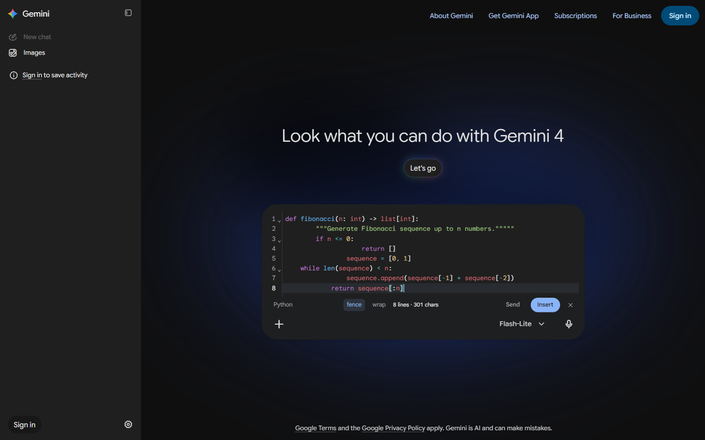
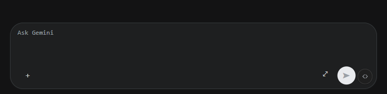
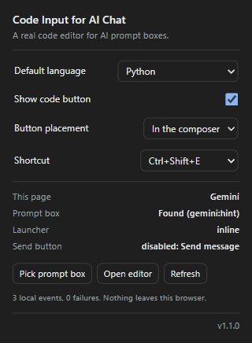

# Code Input for AI Chat

<p align="center">
  
</p>

<p align="center">
  A Manifest V3 browser extension that docks a <strong>real code editor</strong> directly into AI chat prompt boxes.
  <br />
  Syntax highlighting, language-aware indentation, line numbers, bracket matching, comment toggling, and smart fenced blocks.
</p>

<p align="center">
  <a href="https://github.com/deakR/code-inputin-aiwebapps/releases/latest"></a>
  <a href="https://github.com/deakR/code-inputin-aiwebapps/blob/main/LICENSE"></a>
  
  
  
</p>

> [!NOTE]
> Supported sites in this release: **Google Gemini**, **ChatGPT**, **Claude**, **DeepSeek**, **Microsoft Copilot** and **Perplexity**.
> Each site is covered by a small adapter and a local behavioural fixture, not by a single brittle selector.

---

## Overview

Writing code in a standard prompt textarea often strips indentation, mashes bracket pairs, and lacks readability. **Code Input for AI Chat** embeds CodeMirror 6 directly into the prompt box.

The editor keeps the site's own look: the code area follows the composer, the controls sit in a clean strip underneath, and the launcher is a chip inside the composer's action row.

<p align="center">
  
</p>

---

## Why the launcher feels consistent

The launcher is **not** a floating button positioned with JavaScript coordinates anymore. It is inserted into the host composer's own action row, next to the send/attach controls. The browser lays it out, so it cannot be left behind when the composer grows, moves, or animates.

There are two placements:

- **In the composer** (default): the chip is an ordinary child of the action row.
- **Floating corner**: one deterministic viewport fallback for sites whose action row cannot take a child.

Before a row is accepted, the extension inserts the chip, forces layout, and **hit-tests its centre**. If ChatGPT's `composer-accessory` overlay (or any other page layer) is covering that pixel, the row is rejected and the next candidate is tried. Once a row is chosen it is locked to that composer: a page menu that briefly covers the chip only pauses it, it never moves the chip to the other side. The old `above-left` / `inside-left` / `inside-right` coordinate modes are gone — they were the source of the inconsistent placement.

---

## Installation

### 📦 Quick Install (Download & Unpack)

**No Node.js or build tools required.**

1. **Download the pre-packaged zip**:
   👉 **[Download code-input-for-ai-chat-1.1.2.zip](https://github.com/deakR/code-inputin-aiwebapps/releases/latest/download/code-input-for-ai-chat-1.1.2.zip)** (or get it from the [Releases](https://github.com/deakR/code-inputin-aiwebapps/releases) page).
2. **Unzip** `code-input-for-ai-chat-1.1.2.zip` into a folder on your computer.
3. **Load unpacked into your browser**:

#### Chromium (Chrome, Edge, Brave, Arc, Opera)
1. Navigate to your browser's extension page:
   - **Chrome**: `chrome://extensions`
   - **Edge**: `edge://extensions`
   - **Brave**: `brave://extensions`
   - **Arc**: `arc://extensions`
2. Turn on **Developer mode** (toggle in the top-right corner).
3. Click **Load unpacked** and select the unzipped folder.

#### Mozilla Firefox
1. Navigate to `about:debugging#/runtime/this-firefox`.
2. Click **Load Temporary Add-on…**.
3. Select `manifest.json` from the unzipped folder.

4. Open one of the supported AI chat sites and start coding!

---

### Building from Source (Developers)

```bash
git clone https://github.com/deakR/code-inputin-aiwebapps.git
cd code-inputin-aiwebapps

npm install
npm run build
```

Then load the `dist/` directory using the **Load unpacked** steps above.

---

## Supported Sites

| Site | Editor surface | Panel |
|:---|:---|:---|
| **Google Gemini** | Quill contenteditable | Dock inside the composer |
| **ChatGPT** | ProseMirror contenteditable | Floating above the composer |
| **Claude** | ProseMirror contenteditable | Floating above the composer |
| **DeepSeek** | Textarea | Floating above the composer |
| **Microsoft Copilot** | Textarea (open shadow DOM supported) | Floating above the composer |
| **Perplexity** | Contenteditable / textarea | Floating above the composer |

The adapter is a set of **hints**, not the only detection path. See [Resilient detection](#resilient-detection) below.

---

## Key Features

- **Inline composer launcher**: a small `<>` chip in the site's own action row. No viewport coordinates, no follow loop, no slide animation.
- **Resilient detection**: adapter hints → user-picked element → last focused editable → generic candidate scoring. A redesigned page degrades to a usable fallback instead of breaking.
- **Manual repair**: if a site changes too much, the popup's **Pick prompt box** action lets the user click the real input once. The selection is stored locally and survives reloads.
- **Draft autosave**: unsaved code is kept in `storage.local` and restored after a reload. It is cleared after a successful insert.
- **Clipboard fallback**: if every insert strategy fails, the fenced code is copied to the clipboard so the user can paste it manually.
- **Language-aware editing**: 21 supported languages with dedicated indentation units (4 spaces for Python/Java, 2 for JS/TS/HTML, real tabs for Go).
- **Automatic language detection**: pasting code into an empty editor detects the syntax and switches the language mode.
- **Markdown fenced blocks**: automatically formats submitted code with ` ```language ` block wrappers.
- **Duplicate insertion guard**: prevents accidental re-insertion if the code is already in the prompt box.
- **Configurable shortcut**: default <kbd>Ctrl</kbd> + <kbd>Shift</kbd> + <kbd>E</kbd>.
- **Ultra-lean footprint**: the initial content script is ~60 KiB; CodeMirror core and individual language packages load only when the editor opens.
- **100% client-side & private**: zero external network requests, zero telemetry, no third-party tracking. Drafts and repairs stay in local extension storage.

---

## Resilient detection

Every DOM dependency has a fallback:

1. **Adapter hints** — a short, ordered selector list per site.
2. **Picked descriptor** — if the user used *Pick prompt box*, this wins over hints. It stores attributes, stable class tokens, ancestor signatures and a nearby send anchor, not a brittle nth-child path.
3. **Focus memory** — the editable the user clicked is remembered for the session.
4. **Candidate scoring** — every visible textarea/contenteditable is scored on editability, ARIA/placeholder text, proximity to a send control, form membership, position and size. Search boxes and hidden editors are penalised.

The same approach is used for the send button and the action row the launcher docks into. If a send button cannot be found confidently, the extension inserts only and tells the user to press Send instead of clicking a random button.

### When something still changes

The popup shows a local diagnostics section:

- detected adapter and prompt-box provenance
- launcher mode
- send-button state
- recent health events (never sent anywhere)

Use **Pick prompt box** to repair the page. The choice is saved per site.

---

## Screenshots

### 1. Inline launcher chip

A small `<>` chip sits in the composer's own action row, next to the attach/send controls.

<p align="center">
  
</p>

### 2. Extension options and diagnostics

Customize the default language, launcher visibility and placement, and the toggle hotkey. The diagnostics section shows what the extension sees on the current page.

<p align="center">
  
</p>

---

## Browser Compatibility

| Browser | Supported | Minimum Version | Engine | Extension Format |
|:---|:---:|:---:|:---:|:---:|
| **Google Chrome** | Yes | 114+ | Chromium | Manifest V3 |
| **Microsoft Edge** | Yes | 114+ | Chromium | Manifest V3 |
| **Mozilla Firefox** | Yes | 140+ | Gecko | Manifest V3 |
| **Brave Browser** | Yes | 1.50+ | Chromium | Manifest V3 |
| **Arc Browser** | Yes | Latest | Chromium | Manifest V3 |

---

## Keyboard Shortcuts

| Shortcut | Action |
|:---|:---|
| <kbd>Ctrl</kbd> + <kbd>Shift</kbd> + <kbd>E</kbd> (or <kbd>⌘</kbd> + <kbd>Shift</kbd> + <kbd>E</kbd>) | Toggle the code editor (configurable in settings) |
| <kbd>Ctrl</kbd> + <kbd>Enter</kbd> (or <kbd>⌘</kbd> + <kbd>Enter</kbd>) | Insert code into the prompt box |
| <kbd>Tab</kbd> / <kbd>Shift</kbd> + <kbd>Tab</kbd> | Indent / dedent code selection |
| <kbd>Ctrl</kbd> + <kbd>/</kbd> | Toggle line comment |
| <kbd>Ctrl</kbd> + <kbd>F</kbd> | Open CodeMirror in-editor search |
| <kbd>Escape</kbd> | Dismiss autocomplete / close editor |

---

## Supported Languages

| Category | Languages |
|:---|:---|
| **Scripting & Backend** | Python, JavaScript, TypeScript, Go, Rust, Java, Kotlin, Scala, C / C++, C#, PHP, Ruby, Dart, Shell (Bash/Zsh/PowerShell) |
| **Web & Markup** | HTML, CSS, XML, Markdown, JSON, YAML |
| **Data & Query** | SQL |

---

## Development & Verification

### Running the Test Suite

The suite covers the Gemini fixtures, the adapter matrix (ChatGPT, Claude, DeepSeek, Copilot, Perplexity), composer re-renders, the picker repair flow and the popup diagnostics.

```bash
npm test
```

### Probing a site

`tools/probe-site.mjs` drives the built extension against a URL and prints the detected adapter, editable candidates, send buttons and the launcher's actual parent:

```bash
npm run probe -- https://chatgpt.com/
```

For a new site, use the popup diagnostics first; then add adapter hints in `src/sites/` and a fixture under `fixtures/`. The Gemini-specific `tools/live-check.mjs` remains available for deeper insert/dock traces.

### Packaging for Release

```bash
npm run package
```

Generates zip bundles in `release/`:
- `release/code-input-for-ai-chat-<version>.zip` (store upload)
- `release/code-input-for-ai-chat-<version>-source.zip` (source archive for reviewers)

---

## License

MIT License. See [LICENSE](LICENSE) for details.
